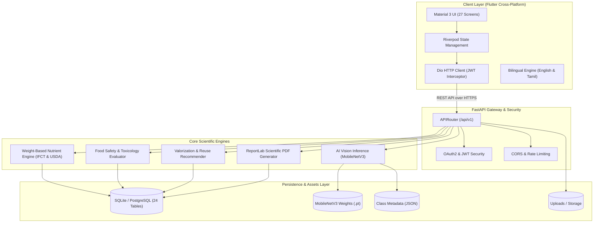

# SMART PEEL AI — SYSTEM ARCHITECTURE DOCUMENTATION

## 1. Executive System Overview
**SMART PEEL AI** is an intelligent, scientifically-referenced software platform designed to identify vegetable peels from photographs, quantify their nutritional composition, evaluate food safety hazards, and provide evidence-ranked food waste valorization strategies.

---

## 2. Multi-Tier Architecture Diagram

---

## 3. Database Schema Specification (24 Relational Tables)

| Domain | Table Name | Purpose |
|---|---|---|
| **Identity & Security** | `user_roles` | Role-based access control (Admin, Researcher, User) |
| | `users` | User credentials, password hash, language preference |
| | `admin_audit_logs` | Immutable audit trail for system events and changes |
| **Taxonomy & Botany** | `plant_parts` | Anatomical parts (peel, flesh, stem, seed) |
| | `vegetables` | 50 botanical vegetable species, taxonomy, hazards |
| **Nutrient & Composition** | `nutrients` | Biochemical master catalogue (29 fields) |
| | `scientific_sources` | Citations (ICMR-NIN IFCT 2017, USDA FDC, FAO) |
| | `nutrient_profiles` | Vegetable peel biochemical link records |
| | `nutrient_measurements` | Quantified values, standard deviations, units |
| | `peel_yield_ratios` | Empirical peel-to-whole ratios (min, max, mean) |
| | `daily_reference_intakes`| RDA standards across demographics |
| | `nutrient_reports` | Archived calculation runs and PDF snapshots |
| **AI & Scans** | `ai_model_versions` | Model registry, checkpoints, class mappings |
| | `scan_records` | User photo uploads, metadata, timestamps |
| | `scan_predictions` | Ranked probabilistic outputs and confidences |
| | `user_confirmations` | Human-in-the-loop validation and corrections |
| | `feedback_records` | Accuracy feedback and correction logs |
| **Safety & Toxicology** | `safety_rules` | Antinutritional hazard rules (solanine, cyanide, etc.) |
| | `safety_evaluations` | Logged safety checks and risk levels |
| **Valorization & Reuse** | `reuse_methods` | Method catalog (composting, biogas, culinary, feed) |
| | `reuse_recommendations` | Evidence-ranked instructions per vegetable peel |
| **Waste Tracking** | `waste_logs` | Diverted weight, category, prevented CO2 emissions |
| **Localization** | `translations` | Bilingual English & Tamil dictionary |

---

## 4. API Endpoints Catalog

- **Health**: `GET /api/v1/health`, `GET /api/v1/health/live`, `GET /api/v1/health/ready`
- **Authentication**: `POST /api/v1/auth/register`, `POST /api/v1/auth/login`, `GET /api/v1/auth/me`, `PUT /api/v1/auth/profile`, `POST /api/v1/auth/change-password`, `GET /api/v1/auth/history`
- **Vegetables**: `GET /api/v1/vegetables`, `GET /api/v1/vegetables/{id_or_slug}`, `POST /api/v1/vegetables`, `PUT /api/v1/vegetables/{id}`, `DELETE /api/v1/vegetables/{id}`
- **AI Scans**: `POST /api/v1/scans/predict`, `POST /api/v1/scans/confirm`, `GET /api/v1/scans/models/active`
- **Nutrients & Estimation**: `GET /api/v1/nutrients`, `POST /api/v1/nutrients/estimate`, `POST /api/v1/nutrients/reports/save`, `GET /api/v1/nutrients/reports/{uuid}`, `GET /api/v1/nutrients/reports/{uuid}/pdf`, `POST /api/v1/nutrients/reports/preview-pdf`
- **Food Safety**: `GET /api/v1/safety/rules`, `POST /api/v1/safety/evaluate`
- **Valorization & Reuse**: `GET /api/v1/reuse/methods`, `GET /api/v1/reuse/recommendations/{slug}`
- **Smart Waste Tracking**: `POST /api/v1/waste-tracking/log`, `GET /api/v1/waste-tracking/logs`, `GET /api/v1/waste-tracking/summary`
- **Admin Console**: `GET /api/v1/admin/overview`, `GET /api/v1/admin/audit-logs`, `GET /api/v1/admin/users`, `PATCH /api/v1/admin/users/{id}/status`, `GET /api/v1/admin/diagnostics`, `POST /api/v1/admin/ai-models/refresh-cache`
- **Localization**: `GET /api/v1/translations/dictionary`, `GET /api/v1/translations`, `POST /api/v1/translations/seed`
